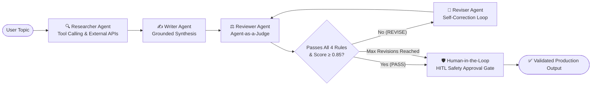

# 🔄 Self-Correcting Multi-Agent AI System

[](https://www.python.org/)
[](https://github.com/langchain-ai/langgraph)
[](https://fastapi.tiangolo.com/)
[](https://www.docker.com/)
[](LICENSE)

An enterprise-grade, stateful **Self-Correcting Multi-Agent AI System** built with **LangGraph StateGraph**, **FastAPI**, and an **Agent-as-a-Judge** evaluation pattern.

Unlike naive single-pass LLM chains that output hallucinations unchecked, this system orchestrates specialized AI agents that collaborate in a cyclic feedback loop—drafting, critiquing against objective verification rubrics, and dynamically self-refining until the response achieves verified quality.

---

## 🏗️ Architecture & State Machine



### Cyclic State Transition Graph
```
           +-----------------------+
           |     START (Topic)     |
           +-----------------------+
                       |
                       v
           +-----------------------+
           |    Researcher Node    |  <--- LLM Tool calling (External APIs/Knowledge)
           +-----------------------+
                       |
                       v
           +-----------------------+
           |      Writer Node      |  <--- Factually grounded draft generation
           +-----------------------+
                       |
                       v
      +--->+-----------------------+
      |    |     Reviewer Node     |  <--- Agent-as-a-Judge evaluation (JSON)
      |    +-----------------------+
      |                |
      |          [Conditional]
      |          /           \
  (REVISE)      /             \  (PASS or Revisions >= MAX)
      |        v               v
      |  +-----------+   +-------------------+
      +--|  Reviser  |   |  Human HITL Gate  |  <--- Safety verification checkpoint
         +-----------+   +-------------------+
                                   |
                                   v
                             +-----------+
                             |    END    |  <--- Zero-hallucination verified output
                             +-----------+
```

---

## 🤖 The Agents & Roles

1. **Researcher Agent (`researcher`)**:
   - Leverages **LLM tool-calling** to query external APIs and knowledge sources.
   - Extracts grounded facts and domain constraints before drafting begins to anchor the model.

2. **Writer Agent (`writer`)**:
   - Synthesizes the initial structured explanation using both the user query and verified research notes.
   - Formats content for beginner clarity, intuitive framing, and conceptual relevance.

3. **Reviewer Agent (`reviewer` / Agent-as-a-Judge)**:
   - Evaluates the candidate draft against 4 objective criteria:
     1. **Beginner Accessibility**: Intuitive and jargon-free phrasing.
     2. **Everyday Analogy**: Explicit, relatable real-world comparison.
     3. **Concrete Example**: Practical snippet or real-world use case.
     4. **Topic Precision**: Zero-hallucination alignment with retrieved research notes.
   - Outputs strict, validated JSON containing a verdict (`PASS` | `REVISE`), quality score ($0.0 - 1.0$), passed/failed rules, and actionable critique.

4. **Reviser Agent (`reviser`)**:
   - Ingests the reviewer's targeted critique and rewrites the content to specifically address each failure point.
   - Passes the improved revision back to the Reviewer Agent for secondary evaluation.

5. **Human-in-the-Loop (HITL) Gate (`human_gate`) & MemorySaver Checkpointer**:
   - Production safety checkpoint ensuring content satisfies verification criteria before emission.
   - Compiled with **LangGraph `MemorySaver` checkpointing** for persistent state management, multi-turn session persistence, and graceful error recovery.

---

## ⚡ Multi-Provider Support

This project supports plug-and-play LLM backends via the `.env` configuration:

- **OpenAI**: `gpt-4o`, `gpt-4o-mini`
- **DigitalOcean Serverless GenAI**: Hosted open-source LLM inference router (`kimi-k3`, `llama`, etc.)
- **Groq LPU**: Ultra-fast inference with `llama-3.3-70b-versatile`

---

## 🚀 Quickstart Guide

### 1. Clone & Set Up Virtual Environment

```bash
git clone https://github.com/Theankitmishra/self-correcting-multi-agent.git
cd self-correcting-multi-agent

# Create virtual environment
python3 -m venv venv
source venv/bin/activate  # On Windows: venv\Scripts\activate

# Install dependencies
pip install -r requirements.txt
```

### 2. Configure Environment Variables

```bash
cp .env.example .env
```

Open `.env` and set your preferred model provider:

```env
LLM_PROVIDER=openai
OPENAI_API_KEY=sk-...
OPENAI_MODEL=gpt-4o-mini

# Or for Groq:
# LLM_PROVIDER=groq
# GROQ_API_KEY=gsk_...

# Or for DigitalOcean Serverless:
# LLM_PROVIDER=digitalocean
# MODEL_ACCESS_KEY=your_do_key
```

### 3. Run the Application

#### A. Interactive Web UI & API (FastAPI)
```bash
python3 app.py
```
Open **[http://localhost:8000](http://localhost:8000)** in your browser to interact with the visual multi-agent workflow.

#### B. Command Line Interface (CLI)
```bash
python3 backend.py "Explain LangGraph StateGraph vs simple LLM chains"
```

#### C. Run Unit Tests
```bash
python3 -m unittest tests/test_workflow.py
```

---

## 🐳 Docker Deployment

Run with Docker in seconds:

```bash
# Build image
docker build -t self-correcting-multi-agent .

# Run container
docker run -p 8000:8000 --env-file .env self-correcting-multi-agent
```

Or using **Docker Compose**:
```bash
docker-compose up --build
```

---

## 📡 API Reference

### 1. `POST /api/run`
Executes the full multi-agent cycle synchronously and returns the complete execution trace.

**Request Body:**
```json
{
  "topic": "What is an AI Agent and how does it make autonomous decisions?"
}
```

**Response:**
```json
{
  "topic": "What is an AI Agent and how does it make autonomous decisions?",
  "provider": "openai",
  "final_answer": "An AI agent is an autonomous software entity...",
  "final_decision": "PASS",
  "final_score": 0.94,
  "total_revisions": 1,
  "events": [
    {
      "agent": "writer",
      "draft": "...",
      "decision": "PENDING_REVIEW"
    },
    {
      "agent": "reviewer",
      "decision": "REVISE",
      "score": 0.65,
      "feedback": "Draft lacks a vivid everyday analogy."
    },
    {
      "agent": "reviser",
      "draft": "...",
      "revision_count": 1
    },
    {
      "agent": "reviewer",
      "decision": "PASS",
      "score": 0.94,
      "feedback": ""
    }
  ]
}
```

### 2. `GET /api/stream?topic=...`
Real-time **Server-Sent Events (SSE)** endpoint streaming node-by-node updates for live frontends.

### 3. `GET /api/health`
Health check endpoint reporting orchestrator and provider status.

---

## 📊 Sample Execution Log

```text
🚀 Running Self-Correcting Multi-Agent System on: 'What is a LangGraph StateGraph?'

--- STEP 1: WRITER AGENT ---
Draft: A LangGraph StateGraph is a state machine that controls agent execution...

--- STEP 2: REVIEWER AGENT (Agent-as-a-Judge) ---
Verdict: REVISE | Quality Score: 0.62 / 1.00
Critique: Missing an everyday real-world analogy and a concrete state dict example.

--- STEP 3: REVISER AGENT (Self-Correction Loop #1) ---
Draft: Think of a LangGraph StateGraph like a smart restaurant kitchen order board...

--- STEP 4: REVIEWER AGENT (Secondary Evaluation) ---
Verdict: PASS | Quality Score: 0.95 / 1.00
Critique: All 4 verification criteria satisfied!

============================================================
Final Decision: PASS (Score: 0.95)
Revisions Used: 1
============================================================
```

---

## 👨‍💻 Author

**Ankit Kumar Mishra**  
- **Education**: M.Tech Computer Science, Delhi Technological University (DTU)
- **Specialization**: Agentic AI Workflows, LLM-based Software Testing Research, Cloud Infrastructure
- **GitHub**: [@Theankitmishra](https://github.com/Theankitmishra)
- **Portfolio**: [ankitkumar.dev](https://theankitmishra.github.io)

---

## 📄 License
This project is open-source under the [MIT License](LICENSE).
